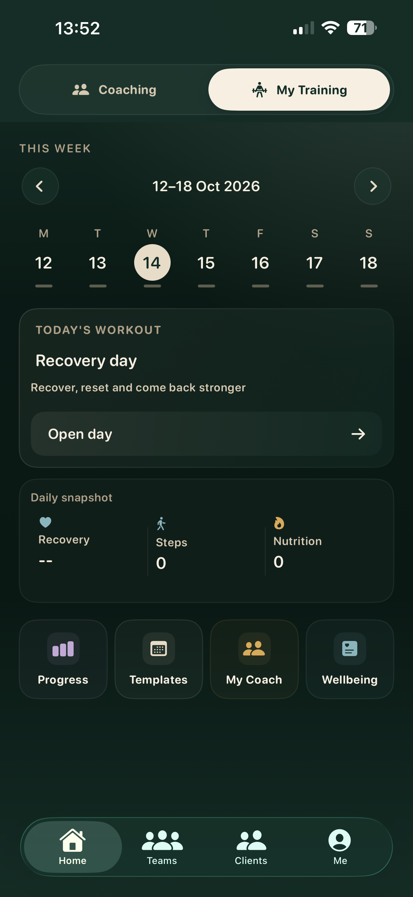
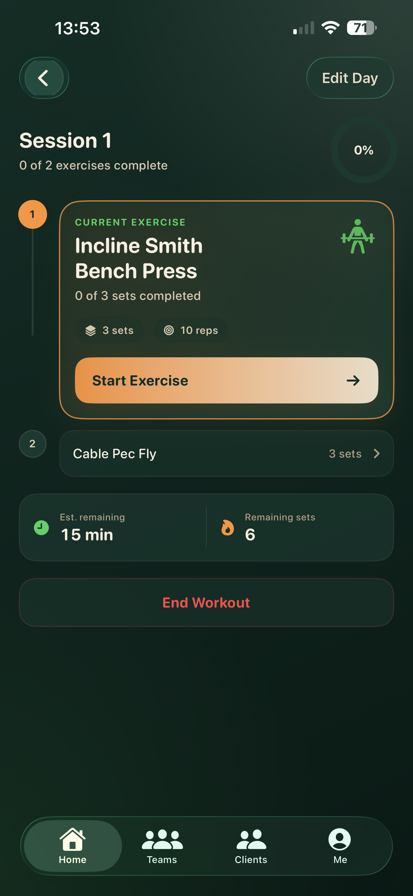
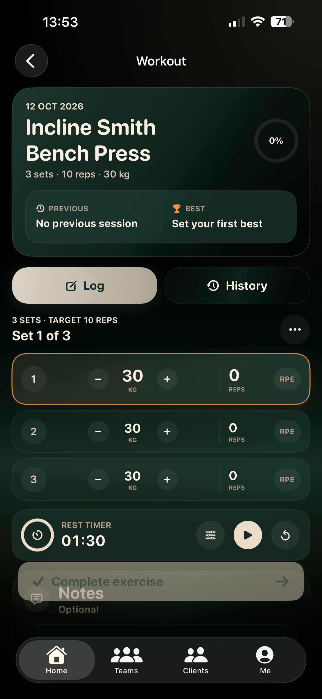
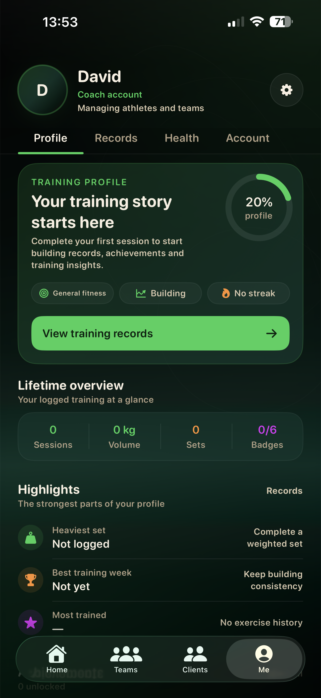

# Fitness Coaching & Workout Planning App

An independently developed iOS app that helps personal trainers and clients organise workouts, log training and track progress.

Built by [David Cole](https://github.com/Coleybluebird07), an Applied Software Engineering graduate from Cardiff University, using Swift and Firebase.

**Status:** In development · Distributed to 16 testers through TestFlight

## Why I’m building it

The app brings workout planning, exercise logging and coaching workflows into one place, helping trainers and clients manage training without switching between separate tools.

## App walkthrough

These screenshots show the app during development, including empty states before training has been logged.

<table>
  <tr>
    <td width="50%" align="center"><strong>Training dashboard</strong>   A weekly calendar, daily workout overview and shortcuts to training tools.</td>
    <td width="50%" align="center"><strong>Workout session</strong>   An ordered exercise list with set targets and session completion indicators.</td>
  </tr>
  <tr>
    <td width="50%" align="center"><strong>Exercise logging</strong>   Set-by-set weight and repetition controls, exercise history and a rest timer.</td>
    <td width="50%" align="center"><strong>Training profile</strong>   A training profile with records, lifetime totals and achievement summaries.</td>
  </tr>
</table>

## My contribution

I am developing this app independently, working across interface design, application logic, Firebase integration and testing.

- Building the iOS experience for workout planning, progress logging and coach/client workflows.
- Integrating Firebase Authentication and Cloud Firestore for authentication and application data.
- Distributing builds through TestFlight to 16 testers.
- Using tester feedback to identify bugs and improve features.

## Technology

| Area | Technology |
| --- | --- |
| iOS development | Swift, SwiftUI, Xcode |
| Authentication | Firebase Authentication |
| Application data | Cloud Firestore |
| Beta distribution | TestFlight |

## Development and testing

The app is under active development. The screenshots document the current interface rather than a finished App Store release. The exercise-logging screenshot includes overlapping controls near the bottom of the screen; layout refinement remains part of the development work.

TestFlight feedback helps guide bug fixes and feature improvements.

## About this repository

This is a visual portfolio showcase containing screenshots and project documentation. The application source code is not included.

## Contact

- [LinkedIn](https://www.linkedin.com/in/david-cole-software-developer)
- [GitHub](https://github.com/Coleybluebird07)
